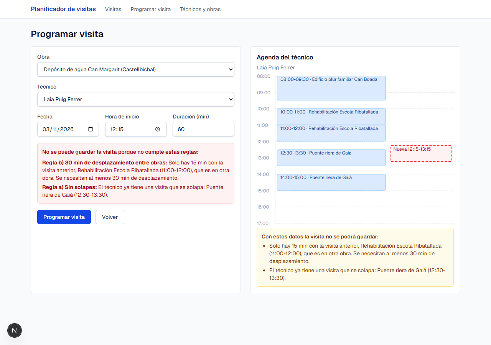
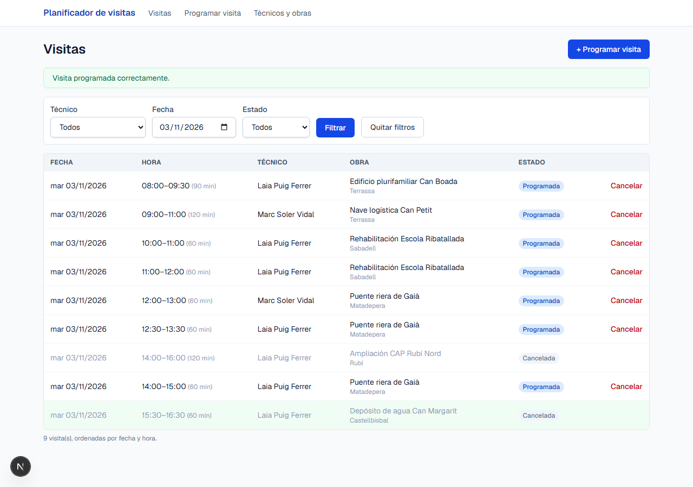

# Planificador de visitas

Aplicación web para planificar las visitas de los técnicos a las obras sin solapes, con tiempo de desplazamiento entre obras y dentro de la jornada laboral.

**Stack:** Next.js 16 (App Router) · React 19 · TypeScript · PostgreSQL · Tailwind CSS · Zod · Vitest

🌐 **Aplicación publicada:** <https://planificador-visitas-gamma.vercel.app> (Vercel + Neon, región Frankfurt). La primera carga puede tardar unos segundos mientras la base de datos gratuita se reactiva.

📄 **[Explicación de la solución (decisiones, supuestos, uso de IA)](EXPLICACION.md)**

| Programar una visita | Listado de visitas |
| --- | --- |
|  |  |

## Funcionalidades

1. **Técnicos y obras**: 4 técnicos y 8 obras de ejemplo (página *Técnicos y obras*).
2. **Programar visita**: obra, técnico, fecha, hora de inicio y duración. Si no se puede guardar, se indica qué regla no se cumple y con qué visita choca.
3. **Reglas de planificación**, comprobadas en el servidor y garantizadas también por la base de datos:
   - a) el técnico no tiene otra visita que se solape;
   - b) entre dos visitas del mismo técnico a obras diferentes hay al menos 30 min;
   - c) la visita empieza y termina entre las 08:00 y las 17:00.
4. **Cancelar**: la visita pasa a *Cancelada*, deja libre el horario y sigue visible.
5. **Listado**: ordenado por fecha y hora, filtrable por técnico, fecha y estado.
6. **Extra:** agenda visual del técnico en el formulario, con aviso en tiempo real antes de guardar.

## Ejecutar en local

Requisitos: **Node.js 22 o superior** y un **PostgreSQL 14 o superior** (con Docker o con una base de datos gratuita de Neon).

```bash
# 1. Clonar e instalar dependencias
git clone https://github.com/joelserranoperez/jesolver.git
cd jesolver
npm install

# 2. Base de datos (elige una opción)
#    A) Docker:
docker compose up -d
#    B) Neon (sin instalar nada): crea un proyecto gratis en https://neon.tech
#       y copia la "connection string".

# 3. Configuración: copia la plantilla y, si usas Neon, pega tu cadena en DATABASE_URL
cp .env.example .env          # en Windows (cmd): copy .env.example .env

# 4. Crear las tablas y cargar los datos de ejemplo
npm run db:setup

# 5. Arrancar
npm run dev
```

Abre <http://localhost:3000>.

> `npm run db:seed` se puede volver a ejecutar en cualquier momento para dejar los datos de ejemplo como al principio. Las visitas de ejemplo se crean para los próximos días a partir de la fecha actual.

### Scripts

| Comando | Qué hace |
| --- | --- |
| `npm run dev` | Servidor de desarrollo |
| `npm run db:migrate` | Aplica las migraciones pendientes de `db/migrations/` |
| `npm run db:seed` | Borra los datos y carga los de ejemplo (`db/seed.sql`) |
| `npm run db:setup` | `db:migrate` + `db:seed` |
| `npm test` | Tests de las reglas de planificación (Vitest) |
| `npm run typecheck` / `npm run lint` | Comprobación de tipos y lint |
| `npm run build` / `npm start` | Build y servidor de producción |

## API

Las validaciones se hacen en el servidor; el formulario es solo un cliente más de la API.

| Método y ruta | Respuesta |
| --- | --- |
| `GET /api/visitas?tecnicoId=&fecha=&estado=` | `200 { visitas }` ordenadas por fecha y hora · `400` si algún filtro no es válido |
| `POST /api/visitas` | `201 { id }` · `400 { tipo: "datos", errores }` · `422 { tipo: "reglas", errores: [{ regla, mensaje }] }` |
| `POST /api/visitas/:id/cancelar` | `200` · `404` si no existe · `409` si ya estaba cancelada |

Ejemplo:

```bash
curl -X POST http://localhost:3000/api/visitas -H "Content-Type: application/json" \
  -d '{"obraId":1,"tecnicoId":1,"fecha":"2026-11-03","horaInicio":"16:30","duracionMin":60}'
# 422 {"tipo":"reglas","errores":[{"regla":"JORNADA","mensaje":"La visita iría de 16:30 a 17:30 y debe..."}]}
```

## Estructura

```
db/
  migrations/001_esquema_inicial.sql  Tablas, restricciones de las reglas (EXCLUDE / CHECK) e índices
  seed.sql                            Datos de ejemplo inventados
scripts/                              Migrador y carga de datos (tsx)
src/
  lib/reglas.ts                       Reglas de planificación (funciones puras) + reglas.test.ts
  lib/validacion.ts                   Esquemas Zod de entrada
  lib/visitas.ts                      Acceso a datos y lógica de crear / cancelar / listar
  app/api/visitas/...                 API REST (Route Handlers)
  app/page.tsx                        Listado de visitas con filtros
  app/visitas/nueva/page.tsx          Formulario para programar visitas
  app/tecnicos-y-obras/page.tsx       Técnicos y obras
  components/                         Formulario, agenda del día y botón de cancelar
```

## Despliegue (Vercel + Neon)

1. Crea una base de datos en [Neon](https://neon.tech) y copia la cadena de conexión **con pooling** (host con `-pooler`).
2. Desde tu equipo, con esa cadena en `.env`, ejecuta `npm run db:setup` para crear las tablas y los datos.
3. En [Vercel](https://vercel.com) importa el repositorio de GitHub y añade la variable de entorno `DATABASE_URL`.
4. Deploy. Las credenciales solo están en `.env` (ignorado por git) y en las variables de entorno de Vercel.
